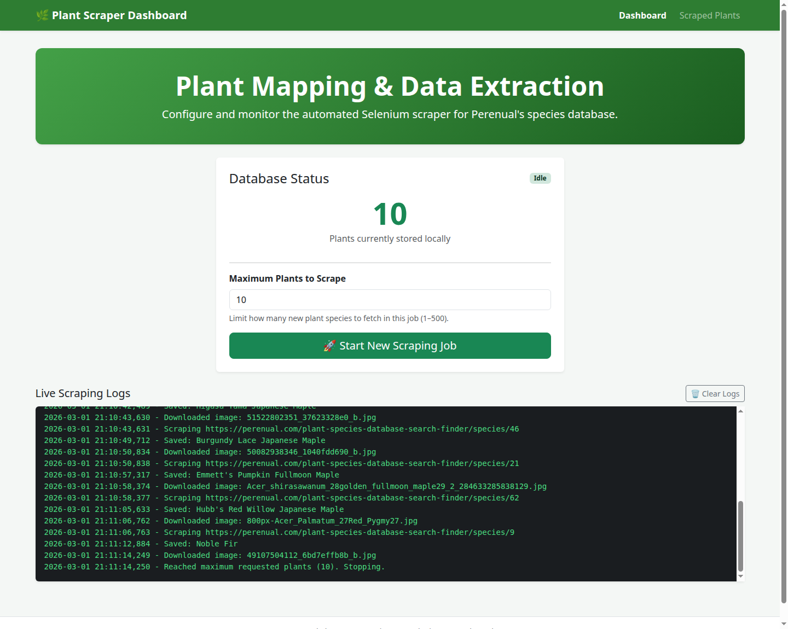
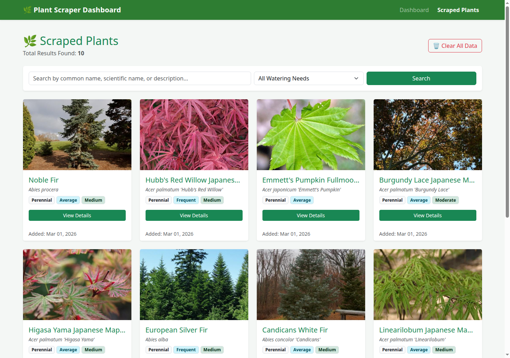
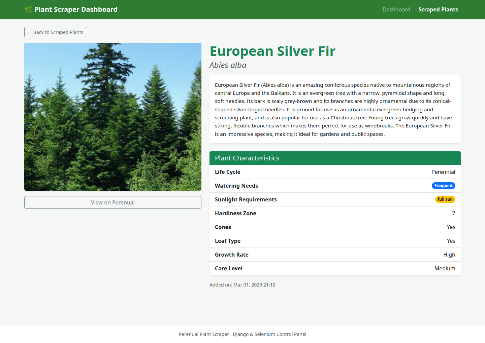

# Perenual Plant Scraper (`scrap_plan`)

A Django web application for scraping, storing, searching, and browsing botanical species data and images from the Perenual Plant Species Database using Selenium and BeautifulSoup4.

## Features

- **Web Control Dashboard**: Start and stop background scraping jobs directly from the browser with configurable plant limits (`1–500`), live status indicators, and auto-polling log output.
- **Automated Scraping Pipeline**: Uses headless Chrome (Selenium) to handle infinite-scroll listing pages and BeautifulSoup4 to extract common names, scientific names, alternative names, descriptions, and care characteristics (`Cycle`, `Watering`, `Sun`, `Hardiness Zone`, `Flowers`, `Soil`, `Cones`, `Leaf`, `Growth Rate`, `Maintenance`, `Care Level`).
- **Local Image Archiving**: Downloads primary plant photos via `requests` and stores them cleanly through Django `ImageField` (`media/plants/`).
- **Duplicate Prevention**: Skips species already saved by `source_url`, `common_name`, or `scientific_name`.
- **Searchable Plant Catalog**: Paginated grid view with search across common/scientific/alternative names and descriptions, plus watering-need filtering and query-preserving pagination.
- **Detailed Species View & Django Admin**: Individual plant pages displaying full botanical attributes, plus full `Plant` and `PlantImage` management in `/admin/`.

## Screenshots

### Control Dashboard & Live Logs


### Scraped Plants Catalog


### Plant Detail View


## Tech Stack

- **Backend**: Python 3.12, Django 6.0
- **Scraping & Parsing**: Selenium 4, BeautifulSoup4, Requests
- **Image Processing**: Pillow
- **Database**: SQLite (default development database)
- **Frontend**: Django Templates, Bootstrap 5.3, Vanilla JavaScript

## Project Structure

```text
scrap_plan/
├── core/
│   ├── settings.py          # Environment-aware Django settings
│   ├── urls.py              # Root URL routing & media serving in DEBUG mode
│   ├── asgi.py
│   └── wsgi.py
├── scraper/
│   ├── services/
│   │   └── perenual_scraper.py  # Selenium + BeautifulSoup scraping service
│   ├── templates/scraper/
│   │   ├── base.html
│   │   ├── dashboard.html
│   │   ├── plant_list.html
│   │   └── plant_detail.html
│   ├── migrations/
│   ├── admin.py             # Admin registrations with inline images
│   ├── models.py            # Plant and PlantImage models
│   ├── tests.py             # Unit and integration tests
│   ├── urls.py              # App routes and JSON control endpoints
│   └── views.py             # Dashboard, catalog, detail, and API views
├── docs/
│   └── screenshots/         # UI screenshots for documentation
├── .env.example             # Sample environment variables
├── .gitignore
├── manage.py
└── requirements.txt
```

## Getting Started

### Prerequisites

- Python 3.12+
- Google Chrome / Chromium installed (Selenium 4 uses Selenium Manager to resolve a matching ChromeDriver automatically)

### Installation

1. **Clone the repository**

   ```bash
   git clone git@github.com:mohamedharf/scrap_plan.git
   cd scrap_plan
   ```

2. **Create and activate a virtual environment**

   ```bash
   python3 -m venv venv
   source venv/bin/activate
   ```

3. **Install dependencies**

   ```bash
   pip install -r requirements.txt
   ```

4. **Configure environment variables (optional for local development)**

   ```bash
   cp .env.example .env
   ```

   Edit `.env` or export `DJANGO_SECRET_KEY`, `DJANGO_DEBUG`, and `DJANGO_ALLOWED_HOSTS` in your shell as needed.

5. **Run database migrations**

   ```bash
   python manage.py migrate
   ```

6. **(Optional) Create an admin superuser**

   ```bash
   python manage.py createsuperuser
   ```

7. **Start the development server**

   ```bash
   python manage.py runserver
   ```

   Open `http://127.0.0.1:8000/` for the Dashboard and `http://127.0.0.1:8000/plants/` for the Plant Catalog.

## Running Tests

The test suite covers models, HTML parsing, WebDriver cleanup, view rendering/filtering, and API endpoints without requiring network access or launching a browser:

```bash
python manage.py test
```

## Routes & API Endpoints

| Route | Method | Description |
| --- | --- | --- |
| `/` | `GET` | Control dashboard with stats, job controls, and live logs |
| `/plants/` | `GET` | Paginated plant catalog (`?q=` search, `?watering=` filter) |
| `/plant/<id>/` | `GET` | Detailed botanical view for a single plant |
| `/trigger/` | `POST` | Start a background scraping job (`{"max_plants": 10}`) |
| `/stop/` | `POST` | Request graceful stop for the running scraping job |
| `/status/` | `GET` | JSON status (`{"is_running": bool, "total_plants": int}`) |
| `/logs/` | `GET` | JSON tail of recent lines from `scraper.log` |
| `/clear-logs/` | `POST` | Clear `scraper.log` and any stale stop flag |
| `/clear-data/` | `POST` | Delete all stored plants and downloaded media files |
| `/admin/` | `GET` | Django Admin interface |

## Responsible Usage

This tool is intended for educational and personal research purposes. Always respect target website rate limits, `robots.txt`, and terms of service when running automated scrapers.
